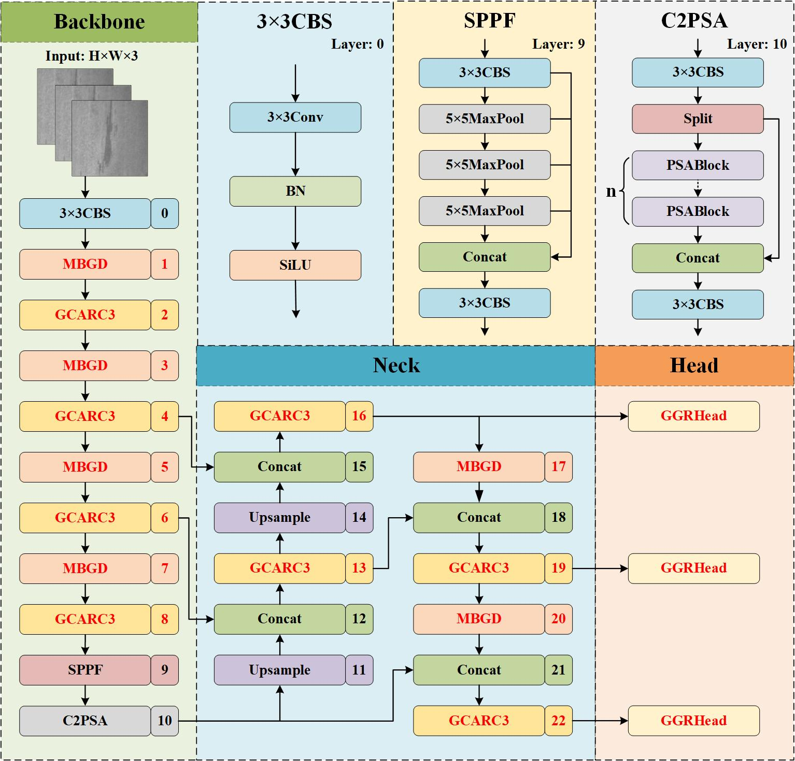

# MGG-YOLO: A Lightweight and Efficient YOLO11-Based Network for Steel Surface Defect Detection
This is the official code of MGG-YOLO.
## MGG-YOLO

## code

The code will be available after the article is accepted.
## Concat
For any question, feel free to email [619085557@qq.com](mailto:619085557@qq.com) (Boyan Hu).
## Ackowlegements
We would like to thank the developers of [YOLO](https://github.com/ultralytics/ultralytics) for their open-source contributions, which greatly supported the development of our work.
